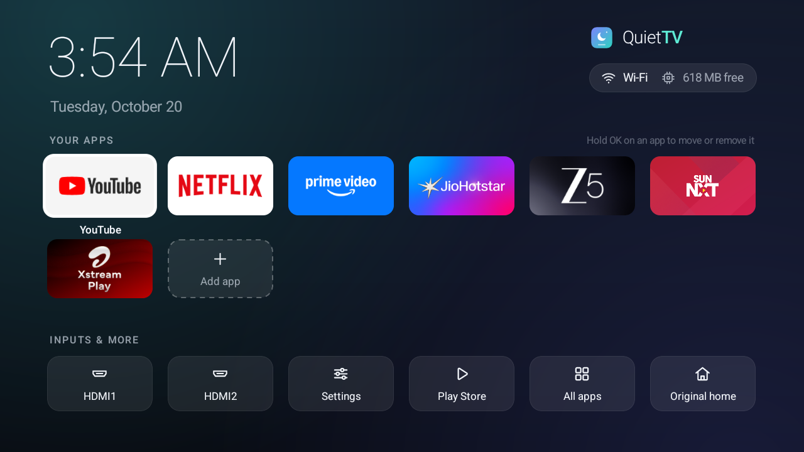
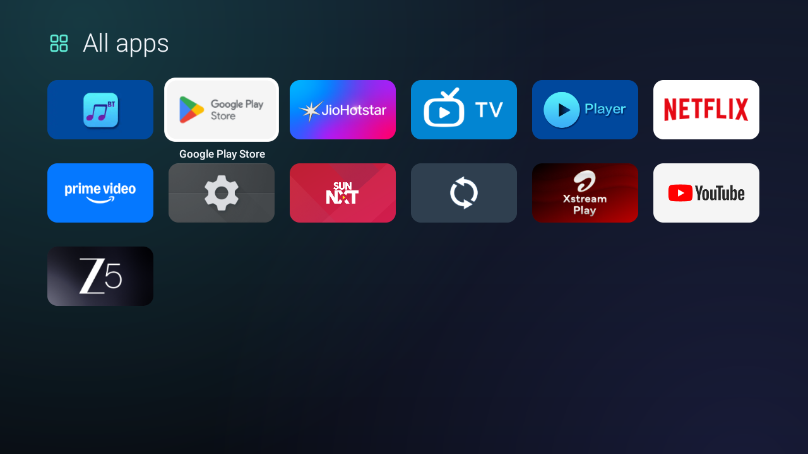

<div align="center">

<picture>
  <source media="(prefers-color-scheme: dark)" srcset="docs/logo-dark.svg">
  
</picture>

### Make a slow Android TV calm and fast again, without breaking it.

A tiny home screen and a careful cleanup. Claude Code or Codex can do it all for you, or you can run four commands yourself.

[](https://github.com/vineetjk/quiettv/releases/latest)
[](https://github.com/vineetjk/quiettv/actions/workflows/build.yml)
[](LICENSE)



</div>

<table>
<tr>
<td width="33%" valign="top"><b>🌙 A calm home screen</b><br>A clock, your apps, your HDMI inputs and Settings. No ads, no rows, no autoplay trailers. The app is under 50 KB.</td>
<td width="33%" valign="top"><b>🧹 Removes the junk</b><br>Turns off ad, demo and vendor apps, plus slow animations. It asks first and never uninstalls anything.</td>
<td width="33%" valign="top"><b>🛡️ Doesn't break Home</b><br>Keeps your TV's own home screen switched on, which avoids the crash loops other tools cause on some Google TVs. Undo anytime.</td>
</tr>
</table>

## Get started

**1. Turn on developer mode on the TV.**
Go to Settings → System → About and press OK on **Build** 7 times. Then, in **Developer options**, turn on **USB debugging** and **Network debugging** (or Wireless debugging). [Stuck?](#help)

**2. Get QuietTV and `adb` on a laptop that's on the same Wi-Fi.**
Download `quiettv-<version>.zip` from the [latest release](https://github.com/vineetjk/quiettv/releases/latest) and unzip it.
You also need `adb`. On a Mac: `brew install android-platform-tools`. On Windows: download Google's [SDK Platform Tools](https://developer.android.com/tools/releases/platform-tools) and use Git Bash.

**3. Let an AI assistant do it, or run the commands yourself.**

<details open>
<summary><b>With <a href="https://claude.com/claude-code">Claude Code</a> or <a href="https://openai.com/codex">Codex</a>: paste this</b></summary>

```text
Help me make my Android TV calm and fast with QuietTV.
My TV is a <brand and model>.

1. Connect to my TV over Wi-Fi with adb. Walk me through anything
   I need to tap on the TV.
2. Get QuietTV from https://github.com/vineetjk/quiettv (the latest
   release zip, or clone the repo) and run: sh quiettv.sh scan <TV_IP>
   Explain the result in plain English: what's safe to turn off,
   what the TV needs, and which apps I use. Check free memory.
3. Ask me in chat before every change. Make changes only with
   quiettv.sh (clean, tune, install), running it with YES=1 after
   I've said yes, so every change is recorded on the TV and can be
   undone with: sh quiettv.sh undo <TV_IP>
4. Never turn off the TV's own home screen or setup app, Google Play
   services, Play Store, Settings, System UI, the keyboard, Bluetooth,
   my HDMI inputs or the TV input framework. If you're not sure,
   leave it on.
5. Install the QuietTV home screen with these apps: <your apps>.
6. Restart the TV once and run: sh quiettv.sh status <TV_IP>
   If anything came back on, run: sh quiettv.sh reapply <TV_IP>
   Show me free memory before and after.
```

</details>

<details>
<summary><b>By hand</b></summary>

```sh
cd quiettv
sh quiettv.sh scan    192.168.1.50   # what's on the TV and what's safe to turn off. Changes nothing.
sh quiettv.sh clean   192.168.1.50   # turn off junk apps, asking about each one
sh quiettv.sh tune    192.168.1.50   # animations, screensaver, sleep timer, background apps
sh quiettv.sh install 192.168.1.50 "com.google.android.youtube.tv,com.netflix.ninja"
```

The first time, the TV asks **"Allow debugging?"**. Tick **Always allow**, then press **Allow**.
Every change is asked about first and recorded on the TV, so you can check or undo it later from any computer:

```sh
sh quiettv.sh status  192.168.1.50   # what changed, and what the TV turned back on
sh quiettv.sh reapply 192.168.1.50   # put back anything the TV undid
sh quiettv.sh undo    192.168.1.50   # put everything back the way it was
```

</details>

> [!NOTE]
> This is what worked for us, not professional advice. Use it at your own risk; you're responsible for your own TV.

## Help

<details>
<summary><b>How do I turn on developer mode and find my TV's IP address?</b></summary>
<br>

1. Open **Settings → System** (or **Device Preferences**) **→ About**, and press OK on **Build** 7 times until it says you're a developer.
2. Go back to **Developer options** and turn on **USB debugging**. If you see **Network debugging** or **Wireless debugging**, turn that on too.
3. Your TV's IP address is under **Settings → Network & Internet →** your Wi-Fi network, or in **About → Status**.
4. The first time your laptop connects, the TV asks "Allow debugging?". Tick **Always allow** and press **Allow**.

Menus differ a bit by brand. If you're stuck, ask Claude: *"I have a \<brand and model\> TV. How do I connect to it with adb over Wi-Fi?"*

</details>

<details>
<summary><b>Which TVs does it work on?</b></summary>
<br>

Android TV and Google TV: TVs and streaming boxes from Sony, TCL, Hisense, Philips, Xiaomi, Acer and others, plus Chromecast with Google TV and Nvidia Shield. It isn't for Roku, Samsung (Tizen), LG (webOS) or Fire TV's home screen.

| Tested on | Android | Notes |
|---|---|---|
| Acer R3G (`R3_GTV`, Realtek, 1.5 GB) | Google TV 14 | Works, including after restarts and app updates. The TV turns junk apps back on at every boot, which `reapply` fixes. Netflix is exempted from power saving by Acer, so it can't be limited. |

Tried it on another TV? Please add it with a pull request, including what worked and what didn't.

</details>

<details>
<summary><b>Why doesn't QuietTV turn off Google TV's home screen like other tools?</b></summary>
<br>

Because on many Google TVs that breaks things. With Google TV's home screen (`com.google.android.apps.tv.launcherx`) off, its setup app takes over the Home button and keeps restarting. On the Acer this was built on, Android itself crashed about once a minute. TCL and Xiaomi owners have reported the same loop ([tv-detox#16](https://github.com/Ansub/tv-detox/issues/16), [#14](https://github.com/Ansub/tv-detox/issues/14), [#21](https://github.com/Ansub/tv-detox/issues/21)).

QuietTV leaves it on. A small accessibility service catches the Home button and opens QuietTV instead, which is how Projectivy Launcher and other open-source launchers do it. QuietTV runs as a "home" task, so leaving an app brings you straight back to it. The details and sources are in [docs/RESEARCH.md](docs/RESEARCH.md).

</details>

<details>
<summary><b>What exactly does it change?</b></summary>
<br>

- **`clean`** offers the apps in [`lists/safe.txt`](lists/safe.txt): ads, store-demo and vendor extras, each with a description. It turns apps off (`pm disable-user`) and never uninstalls them.
- **`tune`** covers animations, the screensaver, the sleep timer, and background limits for apps like Prime Video.
- **`install`** installs the home screen (downloaded from the latest release and checked against its SHA-256) and turns on its Home guard.

Nothing in [`lists/protected.txt`](lists/protected.txt) is ever turned off. That covers Google Play services, Play Store, Settings, System UI, home screens and setup apps, keyboards, the remote and Bluetooth, HDMI and tuner inputs, power, updates, and anything Android keeps running all the time.

Every change is written to `/data/local/tmp/quiettv-journal.txt` on the TV *before* it's made. That list is what `status`, `reapply` and `undo` read.

</details>

<details>
<summary><b>How do I change the apps on the home screen?</b></summary>
<br>

Use the remote. Hold **OK** (or press **Menu**) on an app to:

- **Move it left or right.**
- **Remove it from the home screen.** The app stays installed.
- **App info**, to turn it off or clear its data.
- **Uninstall it**, for apps you installed yourself.

**Add app** puts any installed app on the home screen. **All apps** shows everything. **Original home** opens your TV's own home screen once, and pressing Home brings you back.



</details>

<details>
<summary><b>My TV turned apps back on after a restart</b></summary>
<br>

Some TVs do this on purpose. The Acer this was built on re-enables a list of apps at every boot. Run:

```sh
sh quiettv.sh status  <TV_IP>   # shows BACK ON next to each app the TV re-enabled, and which app did it
sh quiettv.sh reapply <TV_IP>   # turns them off again (only the ones you already approved)
```

</details>

<details>
<summary><b>Home opens my TV's own home screen again</b></summary>
<br>

QuietTV's Home guard was switched off. This usually happens when the app is **force-stopped** (from App info or a "cleaner" app), because Android turns an app's accessibility service off when it's force-stopped. Run `sh quiettv.sh reapply <TV_IP>`, or turn on **QuietTV Home button** in Settings → Accessibility. Avoid force-stopping QuietTV.

</details>

<details>
<summary><b>Is the accessibility service safe?</b></summary>
<br>

It sees only two things: the Home key, and the name of the app whose window just opened. It never reads what's on screen or what you type, and QuietTV has no internet permission. The whole service is [`HomeGuard.java`](app/src/com/quiettv/home/HomeGuard.java), under 100 lines.

</details>

<details>
<summary><b>A remote button stopped working</b></summary>
<br>

QuietTV only catches **Home**. Every other button (Guide, Netflix, YouTube, Input) goes where it always did, and buttons tied to your TV's own home screen should keep working, because that home screen stays on. If something still changed, `sh quiettv.sh undo <TV_IP>` puts everything back. Please open an issue with your TV model.

</details>

<details>
<summary><b>How do I undo everything?</b></summary>
<br>

```sh
sh quiettv.sh undo <TV_IP>
```

It turns every app back on, restores every setting to its old value, switches off the Home guard and uninstalls QuietTV. Your TV goes back to how it was.

</details>

<details>
<summary><b>My TV is stuck restarting</b></summary>
<br>

QuietTV doesn't touch anything the TV needs to start, but if something goes wrong, your laptop can often still connect for a few seconds each time the TV starts:

```sh
adb connect <TV_IP>
adb wait-for-device
for p in $(adb shell pm list packages -d | tr -d '\r' | sed 's/package://'); do adb shell pm enable "$p"; done
adb uninstall com.quiettv.home
```

If the laptop never connects, use the TV's recovery mode or a factory reset (check your TV maker's support page).

</details>

<details>
<summary><b>Can I do it without a computer?</b></summary>
<br>

Not completely. The Home guard is an accessibility service. For apps installed from a downloaded file, Android 13 and later block switching one on ("Restricted setting"), and most TVs have no way to allow it. Installing with `adb` from a computer avoids that, so you need a computer once. After that, everything except `reapply` works without it.

</details>

<details>
<summary><b>For developers: build it yourself, and how releases work</b></summary>
<br>

The app is plain Java with no libraries and no Gradle:

```sh
brew install openjdk@17 && brew install --cask android-commandlinetools
sdkmanager "platforms;android-34" "build-tools;34.0.0"
sh build.sh                       # builds out/quiettv.apk, signed with a local key made on first build
sh quiettv.sh install <TV_IP>     # installs your build instead of the release
```

- `app/src/com/quiettv/home/` holds the code:
  - `HomeActivity`: the home screen.
  - `AppsActivity`: All apps, and the picker for Add app.
  - `HomeGuard`: the Home button.
  - `Ui` and `Tile`: the look.
- `app/res/drawable/` holds the logo and line icons as vector drawables.
- `quiettv.sh` is POSIX `sh` and runs on macOS, Linux and Git Bash.

**Releases are automatic.** Bump `android:versionCode` and `android:versionName` in `app/AndroidManifest.xml` and push to `main`. The [build workflow](.github/workflows/build.yml) checks the scripts and lists and builds a test APK on every push and pull request. When the version is new, it builds the APK signed with the release key from repository secrets and publishes `quiettv.apk`, its `.sha256` and `quiettv-<version>.zip` as a GitHub Release.

`proposals/on-tv-keeper/` holds a design for re-applying changes from the TV itself. It's deliberately not built; its README explains why.

</details>

## Contributing

Pull requests are welcome, especially:

- Your TV in the tested table.
- New lines for `lists/safe.txt`, with the TV you tested them on.
- Fixes that keep working on every TV.

QuietTV sticks to official Android settings and never turns off a TV's own home screen or setup app. Changes that do either won't be merged.

## Credits

Inspired by [tv-detox](https://github.com/Ansub/tv-detox), and built after its approach crashed an Acer Google TV ([tv-detox#21](https://github.com/Ansub/tv-detox/issues/21)). The Home-button technique comes from [LtvLauncher](https://github.com/LeanBitLab/LtvLauncher), [FTVLaunchX](https://github.com/codefaktor/FTVLaunchX), [LauncherHijack](https://github.com/BaronKiko/LauncherHijack) and the [Projectivy Launcher](https://github.com/spocky/miproja1) issue tracker.

---

<div align="center">
<br>
<sub>QuietTV · MIT License</sub>
</div>
