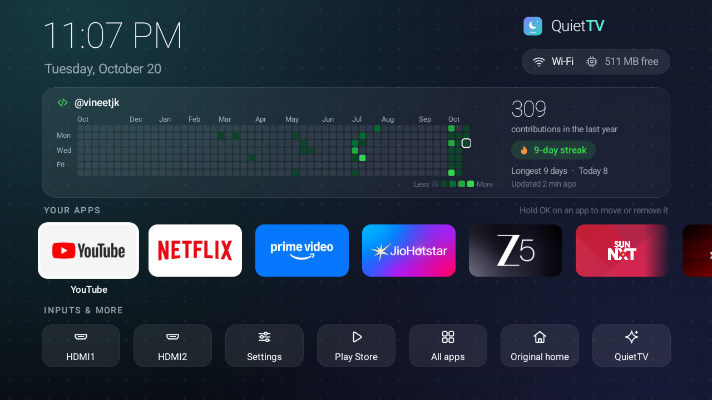

<div align="center">

<picture>
  <source media="(prefers-color-scheme: dark)" srcset="docs/logo-dark.svg">
  
</picture>

A simple, fast home screen for Android TV and Google TV.

[](https://github.com/vineetjk/quiettv/releases/latest)
[](https://github.com/vineetjk/quiettv/actions/workflows/build.yml)

</div>


## What is QuietTV?

Smart TVs get slower over time. The home screen fills up with ads and recommendations, and apps you never use run in the background.

QuietTV gives you a clean home screen with just **your apps, your HDMI inputs and Settings**, and a script that switches off the junk. Everything is reversible.

## How it's different

Most tools replace the TV's home screen by switching off Google TV's own one. On some TVs that makes Android crash and restart over and over. It happened on the Acer TV this project was built on.

QuietTV **leaves the TV's home screen alone**. It just catches the Home button and shows itself instead, so your TV keeps working exactly as before underneath. [Read why →](docs/RESEARCH.md)

## Install

👉 **Step-by-step guide: [vineetjk.github.io/quiettv](https://vineetjk.github.io/quiettv/)**

### Easiest: with an Android phone (new)

Download **[QuietTV Setup](https://github.com/vineetjk/quiettv/releases/latest/download/quiettv-setup.apk)** on your phone and open it. It shows you how to turn on developer mode on the TV, finds the TV on your Wi-Fi, and then does the whole setup, asking before every change. Your phone just needs to be on the same Wi-Fi as the TV. The app is new: if anything goes wrong, its "Get help" button opens an issue with the details filled in.

### With a computer

You need a computer on the same Wi-Fi as your TV.

1. **On the TV:** open Settings → System → About and press OK on *Build* seven times. Then go to *Developer options* and turn on **USB debugging** and **Network debugging**.
2. **On the computer:** install [adb](https://developer.android.com/tools/releases/platform-tools) (on a Mac: `brew install android-platform-tools`), then download and unzip the [latest QuietTV release](https://github.com/vineetjk/quiettv/releases/latest).
3. **Run** this from the unzipped folder, with your TV's IP address:

   ```sh
   sh quiettv.sh install 192.168.1.50
   ```

   The TV asks *"Allow debugging?"*. Tick *Always allow* and press **Allow**. Then press Home on your remote.

> **Using an AI coding assistant?** (Claude Code, Codex, Gemini CLI...) Copy the ready-made prompt in
> [SETUP-WITH-AI.md](SETUP-WITH-AI.md). It does all of this with you, step by step, and asks before every change.

## Commands

| Command | What it does |
|---|---|
| `sh quiettv.sh scan <ip>` | Shows what's on your TV and what's safe to turn off. Changes nothing. |
| `sh quiettv.sh clean <ip>` | Turns off junk apps, one by one, asking each time. |
| `sh quiettv.sh tune <ip>` | Turns off animations and the screensaver, sets a sleep timer, and limits apps that run in the background. |
| `sh quiettv.sh install <ip> [apps]` | Installs the home screen. You can pick the apps: `"com.netflix.ninja,com.google.android.youtube.tv"` |
| `sh quiettv.sh status <ip>` | Shows everything QuietTV changed, and anything the TV switched back. |
| `sh quiettv.sh reapply <ip>` | Puts back changes the TV undid (some TVs do this after every restart). |
| `sh quiettv.sh undo <ip>` | Puts your TV back exactly the way it was. |
| `sh quiettv.sh report <ip>` | Collects details to paste into an issue when you need help. |
| `sh quiettv.sh dev <ip> <github-user> [green\|teal]` | Turns on Dev mode: your GitHub contribution graph on the home screen. `dev <ip> off` turns it off. |

Every change is asked about first and saved in a list on the TV. That's how `status`, `reapply` and `undo` work from any computer.

## Using it on the TV

- **OK** opens an app. **Hold OK** (or press Menu) to move it, remove it, or see App info.
- **Add app** puts any installed app on the home screen. **All apps** shows everything.
- **Original home** opens the TV's own home screen once. Press Home to come back.

## Dev mode

For developers: your **GitHub contribution graph** right on the TV, with your yearly total, current and longest streak, and today's count, over a subtle dot-grid backdrop. Your apps and inputs move into their own rows below it, so nothing is ever covered.



Turn it on from the **✦ QuietTV** tile on the home screen: switch on **Dev mode**, type your GitHub username, and pick **GitHub green** or **QuietTV teal**. Or, from a computer:

```sh
sh quiettv.sh dev 192.168.1.50 your-github-name
```

It reads the same public calendar your GitHub profile shows, so no account, password or token is needed, and only public contributions appear. It refreshes every 3 hours, and keeps the last graph so it still shows when you're offline. QuietTV uses about 55 MB of memory in Dev mode.

## If something's off

| Problem | Fix |
|---|---|
| Home opens the old home screen again | `sh quiettv.sh reapply <ip>`. This happens if QuietTV gets "force stopped", so avoid doing that. |
| Apps came back after a restart | `sh quiettv.sh reapply <ip>` |
| I want everything back to normal | `sh quiettv.sh undo <ip>` |

## Need help?

Stuck at any step? You're not on your own:

1. Run `sh quiettv.sh report <ip>`. It collects your TV model, Android version and what QuietTV changed, and leaves out your IP address.
2. [Open an issue](https://github.com/vineetjk/quiettv/issues/new/choose), pick **Setup help**, and paste the report in.

Someone (the author or someone else from the community) will help you sort it out. Got it working on a TV that isn't listed yet? The **My TV** form helps the next person with the same TV.

## Safety

- Apps are only **turned off**, never deleted.
- QuietTV never touches what the TV needs to run: Google Play, Settings, the keyboard, Bluetooth, HDMI inputs, the TV's own home screen or setup app. The full list is in [`lists/protected.txt`](lists/protected.txt).
- The Home-button helper only sees the Home key and which app opened. It can't read your screen or what you type. [Source](app/src/com/quiettv/home/HomeGuard.java)
- QuietTV only goes online when **Dev mode** is on, and then only to github.com to read your public contribution calendar. With Dev mode off, it makes no network requests at all.
- Tested on an Acer Google TV (Android 14). Other TVs should work, but use it at your own risk.

## Build it yourself

```sh
sh build.sh                       # needs Java 17 and the Android SDK (platform 34)
sh quiettv.sh install <ip>        # installs your own build
```

`build.sh` makes two apps: `out/quiettv.apk` (the home screen, for the TV) and `out/quiettv-setup.apk` (QuietTV Setup, for phones). The phone app writes the same list of changes on the TV as `quiettv.sh`, so the two can be mixed.

New versions are released automatically: bump the version in `app/AndroidManifest.xml` and push to `main`. GitHub Actions builds, signs and publishes both apps, and updates the [setup guide](https://vineetjk.github.io/quiettv/) (`site/`).

## Thanks

Ideas and lessons from [tv-detox](https://github.com/Ansub/tv-detox), [LtvLauncher](https://github.com/LeanBitLab/LtvLauncher), [FTVLaunchX](https://github.com/codefaktor/FTVLaunchX) and [Projectivy Launcher](https://github.com/spocky/miproja1). MIT License.
